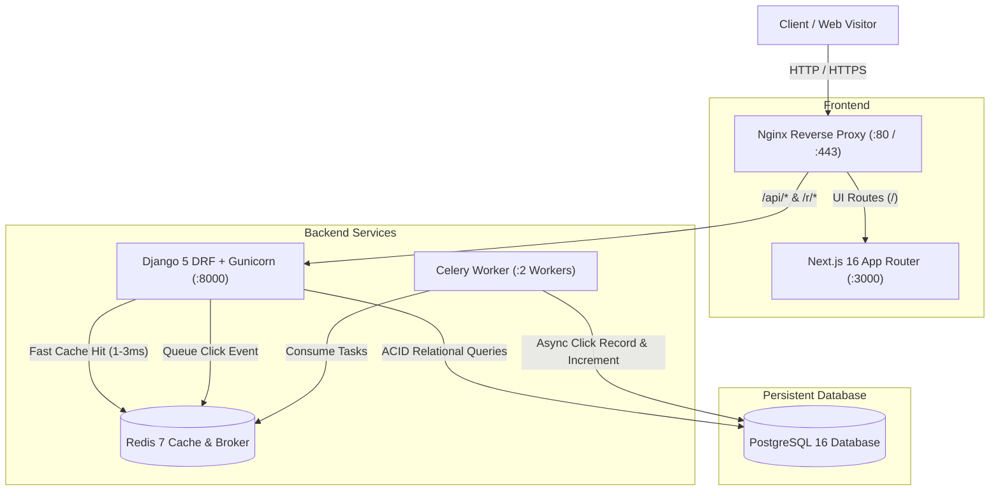

<div align="center">

# Curl

**Enterprise-Grade URL Shortening, Analytics & Link Management Platform**

[](LICENSE)
[](https://nextjs.org/)
[](https://react.dev/)
[](https://www.typescriptlang.org/)
[](https://www.python.org/)
[](https://www.djangoproject.com/)
[](https://www.postgresql.org/)
[](https://redis.io/)
[](https://docs.celeryq.dev/)
[](https://www.docker.com/)

An independently architected, production-grade URL shortener platform with collision-resistant Base62 routing, sub-millisecond Redis caching, anti-SSRF defenses, decoupled Celery telemetry workers, and a modern glassmorphic Next.js dashboard.

</div>

---

## 📖 Table of Contents

- [Why LinkForge?](#-why-linkforge)
- [Key Features](#-key-features)
- [Architecture & Data Flow](#-architecture--data-flow)
- [Technology Stack](#-technology-stack)
- [Local Development Setup](#-local-development-setup)
- [Testing & Quality Gates](#-testing--quality-gates)
- [API Documentation](#-api-documentation)
- [AWS EC2 Deployment & Cost Breakdown](#-aws-ec2-deployment--cost-breakdown)
- [Security & Privacy](#-security--privacy)
- [Attribution & Origin](#-attribution--origin)
- [License](#-license)

---

## 🚀 Why LinkForge?

A URL shortener seems trivial until real-world production engineering questions arise:
- **What happens on short-code collisions under high write load?**
- **How do you keep redirect latency under 5ms without bogging down on analytics writes?**
- **How do you prevent malicious actors from using your platform to perform Server-Side Request Forgery (SSRF) against internal VPC subnets or AWS instance metadata (`169.254.169.254`)?**
- **How do you track granular click metrics without violating visitor privacy (GDPR)?**

LinkForge was designed from the ground up to solve these production challenges with clean architectural separation.

---

## ✨ Key Features

- **⚡ Sub-Millisecond Redirects:** Active links are cached in Redis (`link:<code_or_alias>`), bypassing relational database queries on the hot path.
- **🛡️ Anti-SSRF Protection:** Actively resolves hostnames to verify that destinations do not point to localhost, private RFC 1918 subnets, or cloud metadata endpoints.
- **🔄 Collision-Safe Writes:** Base62 code generator backed by atomic database transactions with retry loops ensures links are never overwritten.
- **📈 Decoupled Telemetry:** Click analytics (device categorization, browser family, OS, referrer domain) are processed asynchronously via Celery workers.
- **🔒 Privacy-Preserving Analytics:** Visitor IP addresses are combined with a secret salt and hashed using SHA-256; raw IPs are never stored in plaintext.
- **🏷️ Custom Branded Aliases:** Support for vanity slugs (e.g., `/r/launch-deal`) with collision checks against reserved paths.
- **⏱️ Deterministic Expiration:** Customizable expiration dates returning HTTP 410 Gone when expired.
- **📊 Modern Next.js Dashboard:** Built with Next.js 16 (App Router), TypeScript, and Tailwind CSS, featuring search, filters, live QR code generator, and interactive analytics charts.
- **📖 OpenAPI 3.0 Documentation:** Interactive Swagger UI and ReDoc powered by `drf-spectacular`.

---

## 🏛️ Architecture & Data Flow



---

## 🛠️ Technology Stack

| Layer | Technologies |
|---|---|
| **Frontend** | React 19, Next.js 16 (App Router), TypeScript, Tailwind CSS, Lucide Icons, QRCode |
| **Backend** | Python 3.12+, Django 5.1, Django REST Framework, Gunicorn, drf-spectacular |
| **Database** | PostgreSQL 16 (Relational models with foreign keys, compound indexes, and atomic transactions) |
| **Caching & Broker** | Redis 7 (In-memory key-value caching and Celery message broker) |
| **Background Queue** | Celery 5.4 (Asynchronous telemetry processing and device parsing) |
| **DevOps & Containers**| Docker, Docker Compose, Nginx, GitHub Actions CI/CD |

---

## 💻 Local Development Setup

### Option 1: Full Stack via Docker Compose (Recommended)

1. **Clone the repository:**
   ```bash
   git clone https://github.com/your-username/linkforge.git
   cd linkforge
   ```

2. **Configure your environment file:**
   ```bash
   cp .env.example .env
   ```

3. **Start all services in Docker:**
   ```bash
   docker compose up -d --build
   ```

4. **Verify container health:**
   ```bash
   docker compose ps
   ```

5. **Create a superuser for the admin dashboard:**
   ```bash
   docker compose exec backend python manage.py createsuperuser
   ```

6. **Access the application:**
   - **Frontend Dashboard:** [http://localhost:3000](http://localhost:3000) (or via Nginx on [http://localhost](http://localhost))
   - **Backend API & Health:** [http://localhost:8000/api/health/](http://localhost:8000/api/health/)
   - **Swagger API Docs:** [http://localhost:8000/api/docs/](http://localhost:8000/api/docs/)
   - **Django Admin:** [http://localhost:8000/admin/](http://localhost:8000/admin/)

---

### Option 2: Running Directly on macOS

#### 1. Backend Setup:
```bash
cd backend
python3 -m venv venv
source venv/bin/activate
pip install -r requirements.txt

# Run migrations (uses SQLite fallback if Postgres is not running locally)
USE_SQLITE=True python manage.py migrate

# Start backend development server
python manage.py runserver 0.0.0.0:8000
```

#### 2. Frontend Setup:
```bash
cd frontend
npm install
npm run dev
```
Open [http://localhost:3000](http://localhost:3000) in your browser.

---

## 🧪 Testing & Quality Gates

### Backend Unit & Integration Tests
LinkForge includes a test suite covering authentication, URL validation, anti-SSRF protections, collision loops, link expiration, user isolation, and click analytics.

```bash
cd backend
venv/bin/python manage.py test apps.authentication.tests apps.links.tests -v 2
```

### Validate OpenAPI Schema Generation
```bash
cd backend
venv/bin/python manage.py spectacular --file schema.yml
```

### Frontend Typechecking & Production Build
```bash
cd frontend
npm run build
```

---

## 📡 API Documentation

For the full endpoint reference and sample payloads, see [`docs/api.md`](docs/api.md).

### Core Endpoints:
- `POST /api/auth/register/` — Register new user account.
- `POST /api/auth/login/` — Authenticate and receive auth token.
- `GET /api/links/` — List user's shortened links with search & pagination.
- `POST /api/links/` — Create shortened link with custom alias and expiration.
- `GET /api/links/{id}/analytics/` — Retrieve aggregated telemetry (devices, browsers, referrers, timeline).
- `GET /r/{code}/` — Fast 302 redirect endpoint with Redis caching.
- `GET /api/health/` — Health check verifying database and cache connectivity.

---

## ☁️ AWS EC2 Deployment & Cost Breakdown

LinkForge includes a complete deployment guide in [`docs/deployment-aws.md`](docs/deployment-aws.md).

### Realistic Monthly Hosting Estimate (us-east-1):
- **EC2 `t3.small` Instance (2 vCPU, 2GB RAM):** ~$15.18 / month
- **EBS gp3 SSD Volume (20 GB):** ~$1.60 / month
- **Elastic IP (IPv4):** ~$3.65 / month
- **Total:** **~$20.40 – $25.00 / month**

*Notice: Cloud compute is not free and accumulates charges continuously while running.*

---

## 🛡️ Security & Privacy

For full security architecture details, see [`docs/security.md`](docs/security.md).

1. **Anti-SSRF Protection:** Actively blocks private IPs (`10.0.0.0/8`, `172.16.0.0/12`, `192.168.0.0/16`, `127.0.0.1`, `169.254.169.254`).
2. **GDPR/CCPA Compliance:** IP addresses are hashed using `SHA-256(IP + salt)`. Raw IPs are never written to disk.
3. **Multi-Tenant Isolation:** Users can only view, modify, or delete their own links.
4. **Zero Hardcoded Secrets:** Production credentials are managed strictly through environment variables.

---

## 📜 Attribution & Origin

LinkForge was designed and implemented by **Arnold Shaju**.

The conceptual problem space—specifically the exploration of collision handling, conditional writes, expiration semantics, and asynchronous analytics decoupling—was inspired by:
- **Reference Project:** `aws-serverless-url-shortener` by [YourCloudDude](https://github.com/yourclouddude/aws-serverless-url-shortener)

**Technical Independence:**
While the reference project was an educational serverless exploration implemented with AWS SAM, Python Lambdas, and Amazon DynamoDB with no frontend or authentication, **LinkForge** is built from the ground up as a complete production-grade SaaS product using a completely separate stack (Next.js, TypeScript, Django, PostgreSQL, Redis, Celery, and Docker Compose). See [`ACKNOWLEDGMENTS.md`](ACKNOWLEDGMENTS.md) for full details.

---

## 📄 License

This project is licensed under the [MIT License](LICENSE).
