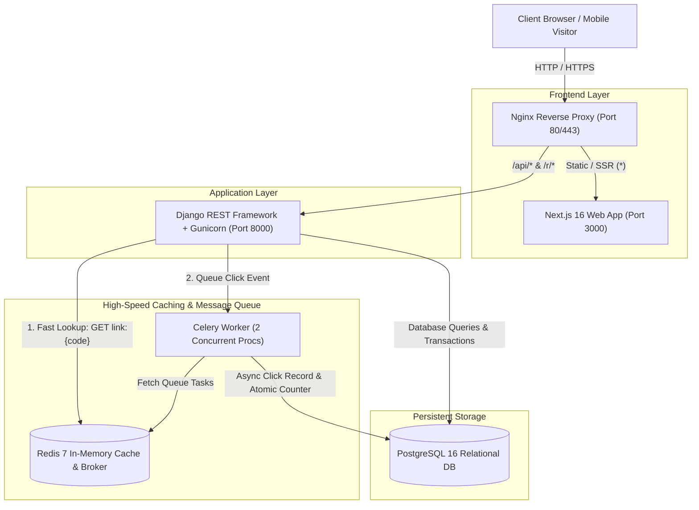

# Curl Architecture Deep Dive

This document details the system design, component responsibilities, data flow, and trade-offs of the Curl URL shortener and telemetry platform.



---

## 1. Architectural Layers & Responsibilities

| Layer | Technology | Primary Responsibility |
|---|---|---|
| **Reverse Proxy & SSL** | Nginx 1.25 Alpine | TLS termination, gzip compression, request routing, security headers |
| **Frontend** | Next.js 16 (App Router), React, TypeScript, Tailwind CSS | Dashboard UI, real-time analytics charts, QR generator, public shortener |
| **Backend API** | Python 3.12, Django 5, DRF, Gunicorn | URL validation, anti-SSRF filtering, user auth, link lifecycle, OpenAPI |
| **Caching Layer** | Redis 7 Alpine | Sub-millisecond redirect lookups, cache invalidation, Celery message broker |
| **Background Processing**| Celery 5.4 | Decoupled click telemetry parsing, device categorization, privacy hashing |
| **Persistent Storage** | PostgreSQL 16 Alpine | ACID relational storage for users, short URLs, custom aliases, and click logs |

---

## 2. Redirection Hot Path Optimization

A critical requirement in URL shortener architecture is keeping redirect latency under 10ms:

```text
Visitor -> Nginx -> RedirectView -> Redis Cache Hit -> HTTP 302 (Immediate Return)
                                         |
                                (Async Queue Event)
                                         v
                                  Celery Worker -> Postgres Click Log
```

1. **Redis Cache First:**
   - The key `link:<code_or_alias>` stores the destination URL and expiration epoch timestamp.
   - If present and valid, the endpoint immediately returns HTTP 302 with `Location: <destination_url>` and `Cache-Control: no-cache, no-store, must-revalidate`.
2. **PostgreSQL Fallback:**
   - If a cache miss occurs, an indexed lookup queries `Q(short_code=code) | Q(custom_alias=code)`.
   - On match, the result is cached into Redis with a 5-minute TTL.
3. **Decoupled Telemetry:**
   - Rather than executing synchronous `INSERT` and `UPDATE` SQL queries during the visitor's HTTP request, the view dispatches `record_click_async.delay(...)`.
   - The Celery worker handles user-agent device parsing, IP hashing, and updates `click_count` atomically using `F('click_count') + 1`.

---

## 3. Collision Resistance & Race Condition Prevention

Generating random short codes can result in collisions as volume scales. Curl employs a dual safeguard:
1. **Cryptographic Randomness:** Codes use an alphanumeric alphabet (`[a-zA-Z0-9]`) with 62^7 (over 3.5 trillion) potential combinations.
2. **Atomic Transactional Check:**
   ```python
   for _ in range(max_retries):
       candidate_code = generate_short_code()
       if not ShortenedURL.objects.filter(short_code=candidate_code).exists():
           with transaction.atomic():
               return ShortenedURL.objects.create(...)
   ```
   If a concurrent worker attempts the same short code, unique constraints on `short_code` and `custom_alias` raise an IntegrityError, which triggers an immediate retry with a new code.

---

## 4. Architectural Comparison: Relational (PostgreSQL) vs Serverless (DynamoDB)

| Dimension | Curl (PostgreSQL + Redis + Celery) | Educational Reference (Serverless DynamoDB) |
|---|---|---|
| **Data Relationships** | Relational: Foreign keys link Users to URLs and URLs to Clicks | Single key-value table: `short_code -> destination_url` |
| **Link Ownership & Auth**| Token & Session Auth; isolated per-user link ownership | Anonymous only; no user isolation or login |
| **Click Analytics** | Deep aggregate queries: devices, browsers, referrers, timeline | None (intentionally omitted to avoid Lambda hot-path latency) |
| **Redirect Speed** | In-memory Redis cache (~1-3ms) | DynamoDB GetItem lookup (~15-25ms + Lambda cold start) |
| **Hosting Portability** | Runs anywhere Docker runs (EC2, DigitalOcean, local Mac, GCP) | Strictly locked into AWS API Gateway, Lambda, and DynamoDB |
