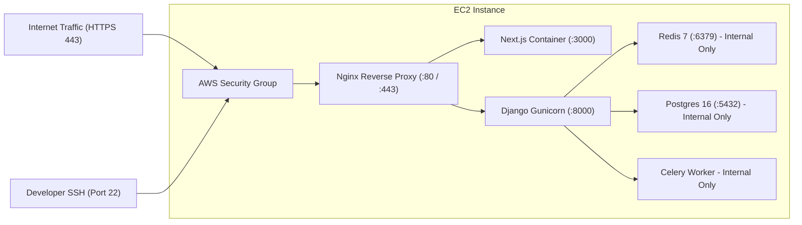

# AWS EC2 Production Deployment Guide

This guide details how to deploy the Curl platform to an Amazon Web Services (AWS) EC2 virtual machine using Docker Compose, Nginx, and Let's Encrypt TLS.

---

## 1. Cost Analysis & Resource Estimates

> [!WARNING]
> Running applications on AWS is **not free**. Cloud resources continue to accumulate charges 24/7 as long as they are provisioned, even when traffic is zero.

### Estimated Monthly Budget (us-east-1)

| AWS Resource | Purpose | Configuration | Estimated Monthly Cost |
|---|---|---|---|
| **EC2 Instance** | Runs Docker Compose stack | `t3.small` (2 vCPU, 2GB RAM) | ~$15.18 / month |
| **EBS Storage** | Root drive & PostgreSQL data | 20 GB gp3 SSD | ~$1.60 / month |
| **Elastic IP** | Public IPv4 address allocation | 1 attached IPv4 address | ~$3.65 / month |
| **Data Transfer** | Outbound HTTP traffic | First 100 GB/month free | ~$0.00 – $1.00 / month |
| **Total Estimated Cost** | Complete production deployment | | **~$20.43 – $25.00 / month** |

*Tip: Stop or terminate the EC2 instance and release the Elastic IP when not in use to avoid ongoing charges.*

---

## 2. Infrastructure Architecture & Security Boundaries



### Security Group Inbound Rules:
- **Port 22 (SSH):** Restricted to your personal IP address (`YOUR_IP/32`).
- **Port 80 (HTTP):** Open to `0.0.0.0/0` (for ACME challenge and HTTPS redirection).
- **Port 443 (HTTPS):** Open to `0.0.0.0/0`.
- **Ports 5432, 6379, 8000, 3000:** **NEVER EXPOSE TO 0.0.0.0/0**. Keep strictly bound to internal Docker bridge network.

---

## 3. Step-by-Step Deployment Instructions

### Phase 1: Local Mac Terminal Preparation

1. **Verify your local Git repository status:**
   ```bash
   git status
   ```

2. **Generate a strong production secret key:**
   ```bash
   python3 -c "import secrets; print(secrets.token_urlsafe(50))"
   ```

3. **Ensure SSH key permissions are secure:**
   ```bash
   chmod 400 ~/.ssh/your-aws-key.pem
   ```

---

### Phase 2: Remote AWS EC2 Configuration (Run over SSH)

1. **Connect to your EC2 instance:**
   ```bash
   ssh -i ~/.ssh/your-aws-key.pem ubuntu@YOUR_EC2_PUBLIC_IP
   ```

2. **Update system packages and install Docker & Docker Compose:**
   ```bash
   sudo apt update && sudo apt upgrade -y
   sudo apt install -y ca-certificates curl gnupg lsb-release git

   # Install Docker Engine
   sudo install -m 0755 -d /etc/apt/keyrings
   curl -fsSL https://download.docker.com/linux/ubuntu/gpg | sudo gpg --dearmor -o /etc/apt/keyrings/docker.gpg
   sudo chmod a+r /etc/apt/keyrings/docker.gpg

   echo \
     "deb [arch=$(dpkg --print-architecture) signed-by=/etc/apt/keyrings/docker.gpg] https://download.docker.com/linux/ubuntu \
     $(lsb_release -cs) stable" | sudo tee /etc/apt/sources.list.d/docker.list > /dev/null

   sudo apt update
   sudo apt install -y docker-ce docker-ce-cli containerd.io docker-buildx-plugin docker-compose-plugin

   # Add ubuntu user to docker group
   sudo usermod -aG docker $USER
   newgrp docker
   ```

3. **Clone your repository:**
   ```bash
   git clone https://github.com/your-username/curl.git /opt/curl
   cd /opt/curl
   ```

4. **Create the production environment file (`.env`):**
   ```bash
   cp .env.example .env
   nano .env
   ```
   *Set `DEBUG=False`, your generated `SECRET_KEY`, strong database credentials, and your production domain.*

5. **Build and launch the containers:**
   ```bash
   docker compose up -d --build
   ```

6. **Verify container health:**
   ```bash
   docker compose ps
   docker compose logs -f backend
   ```

7. **Create a superuser for administrative access:**
   ```bash
   docker compose exec backend python manage.py createsuperuser
   ```

---

## 4. HTTPS & Domain Setup with Let's Encrypt

1. Point your domain (e.g. `links.yourdomain.com`) to your EC2 Elastic IP address via an **A record** in your DNS registrar (Route 53, Cloudflare, Namecheap, etc.).
2. Install Certbot on EC2:
   ```bash
   sudo apt install -y certbot
   sudo certbot certonly --standalone -d links.yourdomain.com
   ```
3. Update `infrastructure/nginx/default.conf` to mount certificates from `/etc/letsencrypt/live/links.yourdomain.com/fullchain.pem` and reload Nginx:
   ```bash
   docker compose restart nginx
   ```

---

## 5. PostgreSQL Backup Strategy

To ensure persistent data is safely preserved:

1. **Manual database dump:**
   ```bash
   docker compose exec postgres pg_dump -U ${POSTGRES_USER:-curl_user} -d ${POSTGRES_DB:-curl_db} | gzip > backup_$(date +%F).sql.gz
   ```

2. **Automated Daily Backup via Cron:**
   ```bash
   crontab -e
   # Add daily backup at 03:00 UTC uploading to private S3 bucket
   0 3 * * * docker compose -f /opt/curl/docker-compose.yml exec -T postgres pg_dump -U curl_user curl_db | gzip | aws s3 cp - s3://your-private-backup-bucket/db/curl_$(date +\%F).sql.gz
   ```
